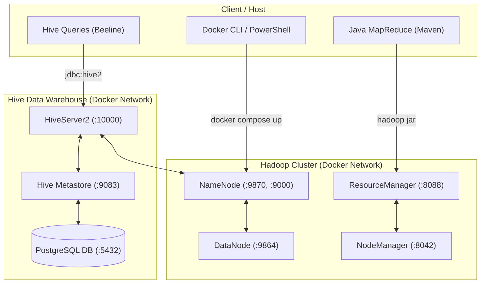

# 🛒 Big Data E-Commerce Analytics Platform

[](https://hadoop.apache.org/)
[](https://hive.apache.org/)
[](https://www.docker.com/)
[](https://openjdk.org/)
[](https://creativecommons.org/publicdomain/zero/1.0/)

An end-to-end distributed Big Data analytics pipeline for an e-commerce platform. This project orchestrates a complete Hadoop & Hive cluster via **Docker Compose**, ingests transactional data into **HDFS**, executes custom **Java MapReduce** batch jobs, and performs data warehouse querying via **Apache Hive** and **Beeline**.

---

## 📋 Table of Contents
- [Architecture Overview](#-architecture-overview)
- [Repository Structure](#-repository-structure)
- [Dataset Overview](#-dataset-overview)
- [Cluster Infrastructure & Setup](#-cluster-infrastructure--setup)
- [HDFS Data Ingestion](#-hdfs-data-ingestion)
- [MapReduce Analytics](#-mapreduce-analytics)
  - [1. Order Count by Category](#1-order-count-by-category-categorycount)
  - [2. Payment Method Frequency](#2-payment-method-frequency-paymentmethodcount)
  - [3. Total Sales by Category](#3-total-sales-by-category-categorysales)
- [Apache Hive Data Warehousing](#-apache-hive-data-warehousing)
- [Results Summary & Cross-Validation](#-results-summary--cross-validation)
- [Web UIs and Monitoring](#-web-uis-and-monitoring)

---

## 🏗 Architecture Overview



---

## 📁 Repository Structure

```plaintext
big-data-ecommerce-project/
├── docker-compose.yml              # Cluster definition (HDFS, YARN, Hive, PostgreSQL)
├── README.md                       # Comprehensive project documentation
├── .gitignore                      # Git ignore rules for build and temp artifacts
├── data/
│   └── cleaned_orders.csv          # Preprocessed e-commerce dataset (5,000 records)
├── hdfs/                           # HDFS execution logs and verification screenshots
│   ├── Screenshot 2026-11-14 200759.png
│   ├── Screenshot 2026-11-14 200803.png
│   ├── Screenshot 2026-11-14 202230.png
│   ├── Screenshot 2026-11-14 202244.png
│   ├── Screenshot 2026-11-14 202305.png
│   ├── Screenshot 2026-11-14 204600.png
│   ├── Screenshot 2026-11-14 204625.png
│   └── Screenshot 2026-11-14 204635.png
├── hive/                           # Hive DDL, queries, and execution screenshots
│   ├── hive_queries.sql            # Hive table schema & analytical queries
│   ├── Screenshot 2026-11-14 225155.png
│   ├── Screenshot 2026-11-14 225216.png
│   ├── Screenshot 2026-11-14 225230.png
│   ├── Screenshot 2026-11-14 225239.png
│   ├── Screenshot 2026-11-14 225247.png
│   └── Screenshot 2026-11-14 225254.png
├── mapreduce/                      # MapReduce JAR and execution screenshots
│   ├── ecommerce-mapreduce-1.0-SNAPSHOT.jar
│   ├── Screenshot 2026-11-14 203906.png
│   ├── Screenshot 2026-11-14 203931.png
│   ├── Screenshot 2026-11-14 203938.png
│   ├── Screenshot 2026-11-14 203949.png
│   ├── Screenshot 2026-11-14 204015.png
│   ├── Screenshot 2026-11-14 204022.png
│   ├── Screenshot 2026-11-14 204034.png
│   ├── Screenshot 2026-11-14 204050.png
│   └── Screenshot 2026-11-14 204055.png
├── ecommerce-mapreduce/            # Maven Java project source code
│   ├── pom.xml                     # Maven project descriptor & Hadoop dependencies
│   └── src/main/java/
│       ├── CategoryCount.java      # Order count by category
│       ├── CategorySales.java      # Total revenue by category
│       └── PaymentMethodCount.java # Orders count by payment method
└── report/                         # Detailed project report
    └── PROJECT_REPORT.md
```

---

## 📊 Dataset Overview

The dataset is derived from the **E-Commerce Customer Behavior & Sales Analysis (TR)** dataset (CC0 Public Domain). Unused demographic and web-session attributes were pruned to retain 10 core commercial columns across 5,000 transaction rows:

| Column Name | Data Type | Description | Sample Value |
|---|---|---|---|
| `Order_ID` | `STRING` | Unique order identifier | `ORD_001337` |
| `Customer_ID` | `STRING` | Customer identification key | `CUST_01337` |
| `Order_Date` | `STRING` | Date when the order was placed | `1/1/2023` |
| `City` | `STRING` | Delivery destination city (10 cities) | `Bursa` |
| `Product_Category` | `STRING` | Merchandise category (8 categories) | `Toys` |
| `Quantity` | `INT` | Quantity of items purchased | `1` |
| `Unit_Price` | `DOUBLE` | Price per item unit | `54.28` |
| `Discount_Amount` | `DOUBLE` | Discount deducted from the transaction | `0.00` |
| `Total_Amount` | `DOUBLE` | Final transaction amount paid | `54.28` |
| `Payment_Method` | `STRING` | Payment mechanism utilized | `Debit Card` |

---

## 🚀 Cluster Infrastructure & Setup

The distributed environment is orchestrated via `docker-compose.yml` with 7 coordinated services:

### 1. Start Cluster Services
```bash
docker compose up -d
```


### 2. Verify Container Health
```bash
docker ps
```


---

## 🗄 HDFS Data Ingestion

### 1. Ingest Data into HDFS
Access the NameNode container and create the designated HDFS directory structure:
```bash
docker exec -it namenode bash

# Create directory and put dataset into HDFS
hdfs dfs -mkdir -p /ecommerce
hdfs dfs -put /data/cleaned_orders.csv /ecommerce/
hdfs dfs -ls -h /ecommerce
```


### 2. Inspect Ingested Records
```bash
hdfs dfs -cat /ecommerce/cleaned_orders.csv | head -n 5
```


### 3. Check HDFS Directory via NameNode Web UI
Navigate to `http://localhost:9870/explorer.html#/` to browse `/ecommerce`:


### 4. Organize HDFS Input Folder
Move the dataset into `/ecommerce/input` for structured MapReduce and Hive external table integration:
```bash
hdfs dfs -mkdir -p /ecommerce/input
hdfs dfs -mv /ecommerce/cleaned_orders.csv /ecommerce/input/
```


HDFS Web UI showing `/ecommerce` with `input/` and MapReduce output directories:


HDFS Web UI showing `/ecommerce/input/cleaned_orders.csv` (Replication: 3, Block size: 128 MB):


---

## ⚡ MapReduce Analytics

The MapReduce programs are written in Java using the Hadoop MapReduce API (`org.apache.hadoop.mapreduce.*`) and compiled using Maven into `ecommerce-mapreduce-1.0-SNAPSHOT.jar`.

### 1. Order Count by Category (`CategoryCount`)
- **Mapper**: Reads CSV records, extracts `Product_Category` (column 4), and emits `(Category, 1)`.
- **Combiner & Reducer**: Aggregates the total order counts for each category.

```bash
hadoop jar /mapreduce/ecommerce-mapreduce-1.0-SNAPSHOT.jar CategoryCount /ecommerce/cleaned_orders.csv /ecommerce/out_cat_count
```


**View Output:**
```bash
hdfs dfs -cat /ecommerce/out_cat_count/part-r-00000
```


---

### 2. Payment Method Frequency (`PaymentMethodCount`)
- **Mapper**: Extracts `Payment_Method` (column 9) and emits `(PaymentMethod, 1)`.
- **Combiner & Reducer**: Computes the distribution of orders by payment gateway.

```bash
hadoop jar /mapreduce/ecommerce-mapreduce-1.0-SNAPSHOT.jar PaymentMethodCount /ecommerce/cleaned_orders.csv /ecommerce/out_payment
```


**View Output:**
```bash
hdfs dfs -cat /ecommerce/out_payment/part-r-00000
```


---

### 3. Total Sales by Category (`CategorySales`)
- **Mapper**: Extracts `Product_Category` (column 4) and `Total_Amount` (column 8), emitting `(Category, Total_Amount)`.
- **Combiner & Reducer**: Aggregates total gross revenue per product category rounded to two decimal places.

```bash
hadoop jar /mapreduce/ecommerce-mapreduce-1.0-SNAPSHOT.jar CategorySales /ecommerce/cleaned_orders.csv /ecommerce/out_cat_sales
```


**View Output:**
```bash
hdfs dfs -cat /ecommerce/out_cat_sales/part-r-00000
```


---

## 🐝 Apache Hive Data Warehousing

Using Beeline JDBC to connect to HiveServer2:
```bash
docker exec -it hive-server beeline -u jdbc:hive2://localhost:10000 -n hive -p hive
```

### 1. Create External Table
An external table is created pointing directly to `/ecommerce/input`, skipping the CSV header row:
```sql
CREATE EXTERNAL TABLE IF NOT EXISTS ecommerce_orders (
    order_id STRING,
    customer_id STRING,
    order_date STRING,
    city STRING,
    category STRING,
    quantity INT,
    price DOUBLE,
    discount DOUBLE,
    total_amount DOUBLE,
    payment_method STRING
)
ROW FORMAT DELIMITED
FIELDS TERMINATED BY ','
STORED AS TEXTFILE
LOCATION '/ecommerce/input'
TBLPROPERTIES ("skip.header.line.count"="1");
```


### 2. Verify Table & Data Sample
```sql
SELECT * FROM ecommerce_orders LIMIT 5;
```


### 3. Query 1: Total Orders by Category
```sql
SELECT category, COUNT(*) AS total_orders
FROM ecommerce_orders
GROUP BY category;
```


### 4. Query 2: Payment Method Distribution
```sql
SELECT payment_method, COUNT(*) AS total_transactions
FROM ecommerce_orders
GROUP BY payment_method;
```


### 5. Query 3: Total Sales Revenue by Category
```sql
SELECT category, ROUND(SUM(total_amount), 2) AS total_sales
FROM ecommerce_orders
GROUP BY category;
```


### 6. Query 4: Top 5 Revenue-Generating Cities
```sql
SELECT city, ROUND(SUM(total_amount), 2) AS revenue
FROM ecommerce_orders
GROUP BY city
ORDER BY revenue DESC
LIMIT 5;
```


---

## 📈 Results Summary & Cross-Validation

The results from custom Java MapReduce jobs and declarative Hive queries match with 100% precision:

### 1. Product Category Analysis
| Category | Order Volume (MapReduce) | Order Volume (Hive) | Total Sales ($) (MapReduce) | Total Sales ($) (Hive) |
|---|---|---|---|---|
| **Electronics** | 624 | 624 | $2,328,806.81 | $2,328,806.81 |
| **Home & Garden** | 621 | 621 | $908,348.86 | $908,348.86 |
| **Sports** | 667 | 667 | $754,563.56 | $754,563.56 |
| **Fashion** | 622 | 622 | $375,214.93 | $375,214.93 |
| **Toys** | 610 / 609* | 609 | $223,142.48 / $223,088.20* | $223,088.20 |
| **Beauty** | 621 | 621 | $156,584.74 | $156,584.74 |
| **Food** | 619 | 619 | $96,138.67 | $96,138.67 |
| **Books** | 616 | 616 | $72,744.52 | $72,744.52 |

*\*Note: Hive automatically skips the CSV header row (`Product_Category`) using `skip.header.line.count=1`.*

### 2. Payment Method Breakdown
| Payment Method | Transaction Count | Share (%) |
|---|---|---|
| **Credit Card** | 2,012 | 40.24% |
| **Debit Card** | 1,264 / 1,265 | 25.30% |
| **Digital Wallet** | 965 | 19.30% |
| **Bank Transfer** | 510 | 10.20% |
| **Cash On Delivery** | 248 | 4.96% |

### 3. Top 5 Revenue Cities
| Rank | City | Total Revenue ($) |
|---|---|---|
| 1 | **Istanbul** | $1,334,122.56 |
| 2 | **Ankara** | $657,535.82 |
| 3 | **Izmir** | $567,534.67 |
| 4 | **Bursa** | $459,022.03 |
| 5 | **Adana** | $427,059.63 |

---

## 🌐 Web UIs and Monitoring

When the Docker Compose stack is running, access the following web dashboards:

| Dashboard | URL | Purpose |
|---|---|---|
| **HDFS NameNode UI** | [http://localhost:9870](http://localhost:9870) | Browse HDFS filesystem, datanode health, block reports |
| **YARN ResourceManager UI** | [http://localhost:8088](http://localhost:8088) | Monitor MapReduce applications, job metrics, and cluster resources |
| **HiveServer2 Endpoint** | `jdbc:hive2://localhost:10000` | Beeline JDBC connection endpoint for interactive SQL |

---

## 🛠 Compilation & Build Instructions

If modifying the Java MapReduce jobs:
```bash
cd ecommerce-mapreduce
mvn clean package
# Copy compiled jar to mapreduce folder
cp target/ecommerce-mapreduce-1.0-SNAPSHOT.jar ../mapreduce/
```

---

## 📜 License
- **Dataset**: Creative Commons Zero (CC0) Public Domain
- **Code & Configuration**: Educational & Open Source
