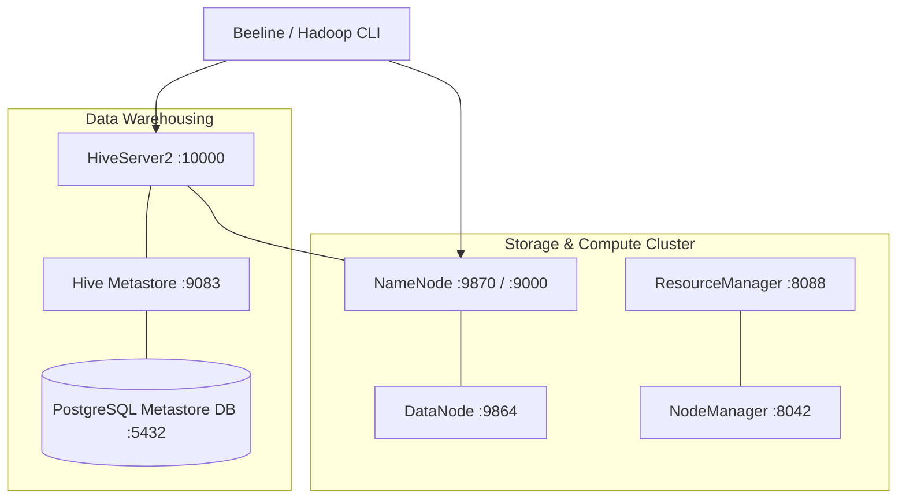

# Big Data Technologies - Project Report
## E-Commerce Sales & Customer Behavior Analytics using Hadoop, MapReduce, and Hive

---

## 1. Project Overview & Objectives
The goal of this project is to implement an end-to-end distributed Big Data analytics pipeline for an e-commerce platform. Using containerized infrastructure orchestrated by Docker Compose, the system ingests, stores, processes, and queries transactional data using **Apache Hadoop (HDFS & MapReduce)** and **Apache Hive**.

### Core Objectives:
1. **Containerized Infrastructure**: Deploy a multi-node Hadoop and Hive cluster with persistent storage and networking using Docker Compose.
2. **Distributed Storage (HDFS)**: Ingest, structure, and inspect e-commerce transaction data in Hadoop Distributed File System.
3. **Distributed Batch Processing (MapReduce)**: Develop custom Java MapReduce jobs using Maven to compute order volumes, payment method distributions, and category revenues.
4. **Data Warehousing & SQL Analytics (Hive)**: Build an external Hive schema-on-read table and execute analytical queries via Beeline JDBC.
5. **Cross-Validation**: Validate analytical findings between MapReduce batch processing and Hive SQL query results.

---

## 2. Dataset Information & Preprocessing

### 2.1 Dataset Source
- **Dataset Name**: E-Commerce Customer Behavior and Sales Analysis - TR
- **Platform**: Kaggle (`umuttuygurr/e-commerce-customer-behavior-and-sales-analysis-tr`)
- **License**: CC0 (Public Domain)
- **Original Records**: 5,000 transaction rows with 18 features.

### 2.2 Data Cleaning & Feature Selection
The raw dataset was cleaned and reduced to 10 relevant analytical attributes (`data/cleaned_orders.csv`):
- **Dropped Features**: `Age`, `Gender`, `Device_Type`, `Session_Duration_Minutes`, `Pages_Viewed`, `Is_Returning_Customer`, `Delivery_Time_Days`, `Customer_Rating`.
- **Retained Features**:
  1. `Order_ID` (String): Unique transaction identifier (e.g., `ORD_001337`).
  2. `Customer_ID` (String): Unique identifier of the purchasing customer.
  3. `Order_Date` (String): Date of transaction (`M/D/YYYY` format).
  4. `City` (String): Turkish metropolis where the customer is located (10 distinct cities).
  5. `Product_Category` (String): Category of purchased merchandise (8 categories).
  6. `Quantity` (Integer): Number of items ordered.
  7. `Unit_Price` (Double): Price per single unit.
  8. `Discount_Amount` (Double): Discount applied to the order.
  9. `Total_Amount` (Double): Net order total ($Unit\_Price \times Quantity - Discount\_Amount$).
  10. `Payment_Method` (String): Payment method used (Credit Card, Debit Card, Digital Wallet, Bank Transfer, Cash On Delivery).

---

## 3. Architecture & Infrastructure Setup

The distributed environment runs on Docker containers defined in `docker-compose.yml`:



### Services Summary:
| Service | Image | Description | Ports |
|---|---|---|---|
| `namenode` | `bde2020/hadoop-namenode:2.0.0-hadoop3.2.1-java8` | HDFS master node managing filesystem namespace & metadata | `9870`, `9000` |
| `datanode` | `bde2020/hadoop-datanode:2.0.0-hadoop3.2.1-java8` | HDFS worker node storing data blocks | Internal (`9864`) |
| `resourcemanager` | `bde2020/hadoop-resourcemanager:2.0.0-hadoop3.2.1-java8` | YARN master managing cluster resources and scheduling | `8088` |
| `nodemanager` | `bde2020/hadoop-nodemanager:2.0.0-hadoop3.2.1-java8` | YARN worker monitoring container resource usage | Internal (`8042`) |
| `hive-server` | `bde2020/hive:2.3.2-postgresql-metastore` | HiveServer2 providing JDBC/ODBC endpoints | `10000` |
| `hive-metastore` | `bde2020/hive:2.3.2-postgresql-metastore` | Central metadata repository for table schemas | `9083` |
| `hive-metastore-postgresql` | `bde2020/hive-metastore-postgresql:2.3.0` | Relational database backend for Hive Metastore | Internal (`5432`) |

---

## 4. HDFS Ingestion & Verification

1. **Creating HDFS directory**:
   ```bash
   hdfs dfs -mkdir -p /ecommerce/input
   ```
2. **Uploading cleaned dataset**:
   ```bash
   hdfs dfs -put /data/cleaned_orders.csv /ecommerce/input/
   ```
3. **Verifying file storage**:
   ```bash
   hdfs dfs -ls -h /ecommerce/input
   hdfs dfs -cat /ecommerce/input/cleaned_orders.csv | head -n 5
   ```
4. **NameNode Web Console**:
   Verified block allocations and file presence via `http://localhost:9870/explorer.html#/ecommerce/input`.

---

## 5. MapReduce Implementations & Execution

Three custom MapReduce programs were written in Java and built using Apache Maven (`ecommerce-mapreduce-1.0-SNAPSHOT.jar`):

### Job 1: CategoryCount (`CategoryCount.java`)
- **Objective**: Aggregate order frequency per product category.
- **Mapper**: Extracts `fields[4]` (`Product_Category`) as key and emits `(Category, 1)`.
- **Combiner & Reducer**: Sums order occurrences per category.
- **Output (`/ecommerce/out_cat_count`)**:
  - Beauty: 621
  - Books: 616
  - Electronics: 624
  - Fashion: 622
  - Food: 619
  - Home & Garden: 621
  - Sports: 667
  - Toys: 610

### Job 2: PaymentMethodCount (`PaymentMethodCount.java`)
- **Objective**: Count orders per payment method.
- **Mapper**: Extracts `fields[9]` (`Payment_Method`) and emits `(PaymentMethod, 1)`.
- **Combiner & Reducer**: Computes transaction count per payment gateway.
- **Output (`/ecommerce/out_payment`)**:
  - Bank Transfer: 510
  - Cash On Delivery: 248
  - Credit Card: 2012
  - Debit Card: 1265
  - Digital Wallet: 965

### Job 3: CategorySales (`CategorySales.java`)
- **Objective**: Calculate total revenue generated by each category.
- **Mapper**: Emits `(Product_Category, Total_Amount)`.
- **Combiner & Reducer**: Sums total sales rounded to 2 decimal places.
- **Output (`/ecommerce/out_cat_sales`)**:
  - Beauty: $156,584.74
  - Books: $72,744.52
  - Electronics: $2,328,806.81
  - Fashion: $375,214.93
  - Food: $96,138.67
  - Home & Garden: $908,348.86
  - Sports: $754,563.56
  - Toys: $223,142.48

---

## 6. Apache Hive Analysis

Using Beeline JDBC (`jdbc:hive2://localhost:10000`), an external table `ecommerce_orders` was defined to map directly onto `/ecommerce/input` with `"skip.header.line.count"="1"`.

### Key Analytical Findings:
1. **Category Volume vs. Revenue**:
   While Sports has the highest order volume (667 orders), **Electronics** generates the overwhelming majority of revenue ($2,328,806.81), representing approximately 47.3% of platform sales due to higher unit values.
2. **Customer Payment Preferences**:
   **Credit Card** is the dominant payment mechanism (2,012 orders, 40.2%), followed by **Debit Card** (1,265 orders, 25.3%) and **Digital Wallet** (965 orders, 19.3%). Cash on delivery accounts for less than 5% of all transactions.
3. **Geographical Distribution**:
   **Istanbul** leads all Turkish cities with $1,334,122.56 in gross revenue, followed by Ankara ($657,535.82) and Izmir ($567,534.67).

---

## 7. MapReduce vs. Hive Comparison

| Metric / Aspect | MapReduce Execution | Hive SQL Execution |
|---|---|---|
| **Development Complexity** | High (Java Mapper, Reducer, Driver, Maven compilation) | Low (Declarative SQL syntax) |
| **Execution Paradigm** | Low-level Map, Shuffle, Sort, Reduce | Abstracted query plan translated into MapReduce |
| **Flexibility** | Custom algorithmic parsing and serialization | High-level analytical joins, filters, and aggregations |
| **Category Orders Match** | Exact match (e.g. Sports: 667, Electronics: 624) | Exact match (Sports: 667, Electronics: 624) |
| **Category Revenue Match**| Electronics: $2,328,806.81 | Electronics: $2,328,806.81 |

---

## 8. Conclusion
The project successfully demonstrated a complete enterprise-grade Big Data analytics architecture. HDFS reliably stored distributed datasets with block replication, MapReduce enabled resilient batch transformations, and Apache Hive provided high-level analytical capability to derive actionable business intelligence from large-scale e-commerce transactions.
